# Credit Card Default Prediction

Predicting which credit card clients will default next month, using a logistic regression and a neural network written from scratch in NumPy, and benchmarking them against gradient-boosted trees (XGBoost).

Data: [Default of Credit Card Clients](https://archive.ics.uci.edu/dataset/350/default+of+credit+card+clients) (UCI). 30,000 clients in Taiwan, April to September 2005; 22% defaulted in October.

| model | features | test ROC AUC | defaulters caught | false alarms |
|---|---|---|---|---|
| logistic regression (from scratch) | 18 | 0.782 | 864 / 1,326 | 1,053 |
| neural network (from scratch) | 68 | 0.785 | 859 / 1,326 | 1,058 |
| **XGBoost (tuned)** | 68 | **0.786** | 854 / 1,326 | 984 |

All three are within the test set's noise (± 0.007) of each other and of the best published result on this dataset (0.79).

Install with `pip install -r requirements.txt`, then run `code/eda.ipynb` followed by any model notebook. The data is downloaded from UCI automatically (`data/` is not in the repo).

## Data

Each client has a credit limit, demographics, and six months of payment history:

| feature | meaning |
|---|---|
| `credit_limit` | credit limit (TWD) |
| `sex`, `education`, `marital_status`, `age` | demographics |
| `late_sep` … `late_apr` | repayment status (−2 = no balance, −1 = paid in full, 0 = paid the minimum, 1–9 = months late) |
| `bill_sep` … `bill_apr` | bill statement amount (TWD) |
| `paid_sep` … `paid_apr` | amount paid that month (TWD) |
| `default` | defaulted in October (target) |

Within each group the months are strongly correlated. Bills barely change from one month to the next (r = 0.93 for July vs August, boxed in red) because unpaid balances carry over.

  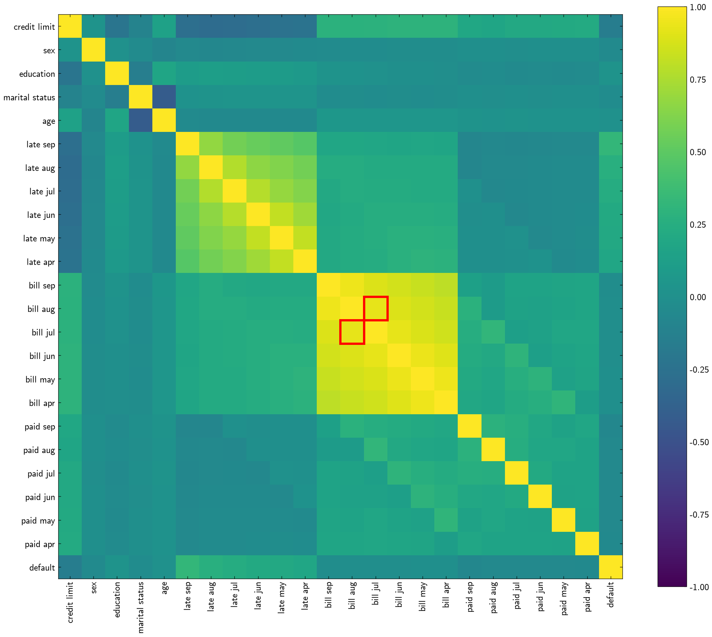
  

**Cleaning.** Undocumented `education` and `marital_status` codes are folded into "other". 6.4% of clients have a negative bill (a credit balance from overpaying); these are clipped to 0 and counted in `credit_balance_months`, and 6 clients whose credit balance exceeded their limit are dropped. Bill and payment amounts are heavily right-skewed (`paid_sep` skewness 14.7), so they are replaced by `log(1 + x)`.

**Engineered features (68 candidates in total)**

| group | examples |
|---|---|
| category dummies | `female`, `edu_university`, `late_sep_2`, `late_sep_3plus` |
| utilization | `util_sep` … `util_apr` = bill ÷ credit limit |
| interactions | `late_x_util`, `months_late_x_util`, `late_sep_x_aug` |
| behaviour across months | `months_since_late`, `max_late`, `zero_pay_months`, `pay_ratio_*` (paid ÷ previous bill), trends |
| six-month summaries | `months_late_2plus`, `late_streak`, `unpaid_*`, `util_mean`, `util_max`, `total_pay_ratio` |

The last two groups combine several columns into one, which a tree (one split at a time) or a linear model cannot do by itself. `months_late_2plus` and `late_streak` end up with the highest correlation with default of any feature (0.40 and 0.39).

## Train / test split

  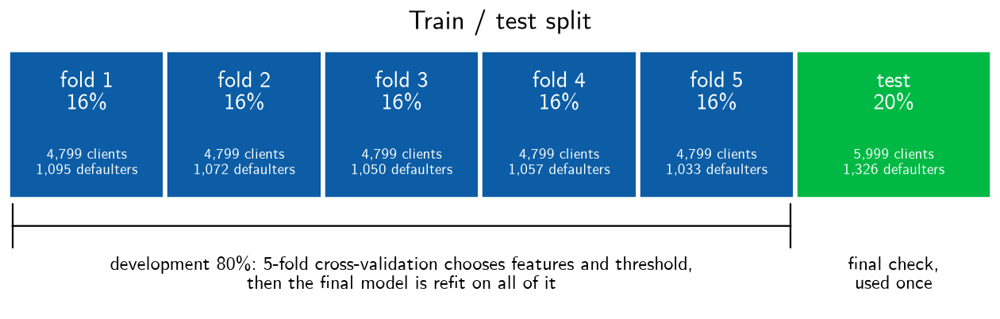
  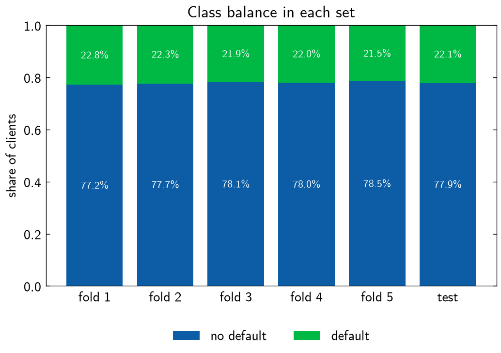

- **Test, 20% (6,000 clients).** Used once per model, for the final numbers. With about 1,300 defaulters its AUC has a standard error of 0.008; a 1,000-client test set would give about 0.02, too noisy to compare models.
- **Development, 80% (24,000 clients), in 5 folds.** Features, settings and thresholds are all chosen by cross-validation on these folds, then each model is refit on all 24,000.
- Every set has 21.5–22.8% defaulters, so no stratification is needed.

**Threshold.** Each model flags a client when its predicted probability is above a threshold chosen on out-of-fold predictions to catch 65% of defaulters (0.20–0.22). At 0.5, most defaulters would be missed.

## Logistic regression

`logistic_regression.ipynb`. The probability that client $i$ defaults is

$$p_i = \sigma(\theta_0 + \theta_1 x_{i1} + \dots + \theta_k x_{ik}), \qquad \sigma(z) = \frac{1}{1 + e^{-z}}$$

The parameters $\theta_0, \dots, \theta_k$ are fit by gradient ascent on the log-likelihood $\ell(\theta) = \sum_i [y_i \log p_i + (1-y_i)\log(1-p_i)]$, whose derivative for each parameter is $\partial \ell / \partial \theta_j = \sum_i (y_i - p_i)\,x_{ij}$ (with $x_{i0} = 1$ for the intercept $\theta_0$). Features are standardized; learning rate 0.5, 3,000 iterations.

**Forward selection.** Start with the intercept, then repeatedly add the candidate that most raises the cross-validated log-likelihood; stop when the gain is below 8 (about 0.0003 per client). This keeps **18 of 68** candidates, and `months_since_late` enters first.

| average log-likelihood per client | |
|---|---|
| all $\theta_j = 0$ (every $p_i = 0.5$) | −0.693 |
| base rate 22% for everyone | −0.528 |
| 26 raw features (in-sample) | −0.464 |
| 18 selected features, cross-validated | **−0.431** |

On test: **AUC 0.782** (95% interval 0.767–0.796), up from 0.732 for the 26 raw features.

  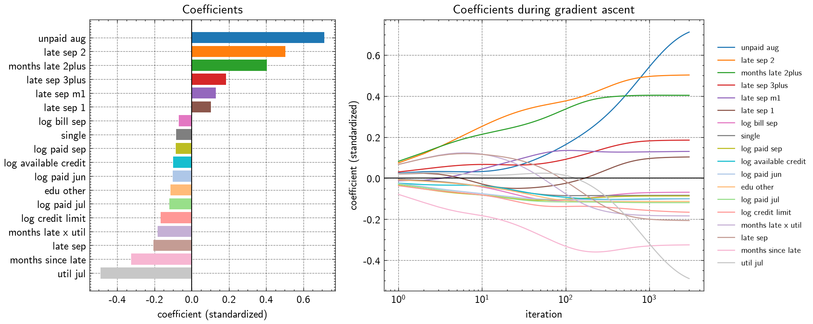

Payment history dominates: being 2+ months late in September (`late_sep_2`, `late_sep_3plus`), the number of months 2+ months late, and how recently the client was last late. `unpaid_aug` (+0.71) and `util_jul` (−0.49) nearly cancel: August's unpaid amount is roughly July's bill minus the payment, so together they mostly measure *how much of the bill was left unpaid*. Because they overlap, their individual coefficients are still drifting apart after 3,000 iterations and should not be read on their own.

  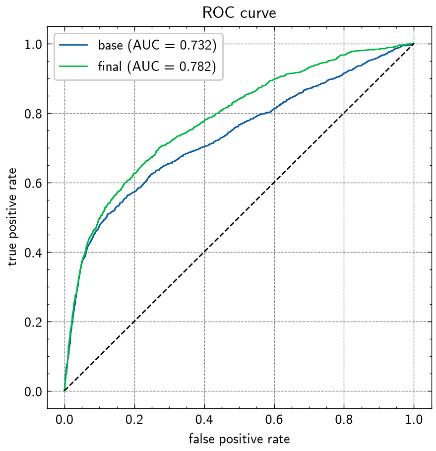
  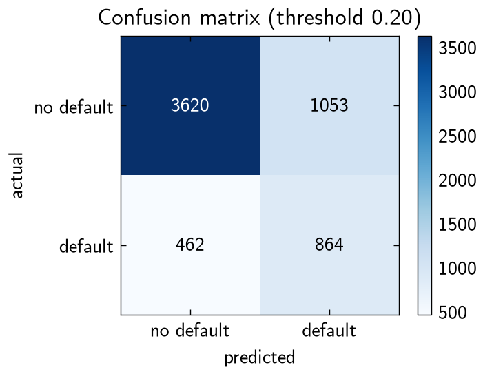

Choosing the threshold

There is no single best threshold; it depends on how costly a missed defaulter is compared with a false alarm. Thresholds that other criteria pick on the out-of-fold predictions:

| chosen to maximize | threshold |
|---|---|
| accuracy | 0.49 |
| F1 | 0.27 |
| Youden's J (catch rate + true-negative rate − 1) | 0.20 |
| savings when a missed defaulter costs 2 / 3 / 5 false alarms | 0.32 / 0.27 / 0.15 |

If a missed defaulter costs $k$ false alarms, perfectly calibrated probabilities give a cost-optimal threshold of $\frac{1}{1 + k}$: 0.33, 0.25 and 0.17 for $k = 2, 3, 5$.

How precise is a test AUC?

The AUC is the probability that a random defaulter gets a higher score than a random non-defaulter. Its noise depends mostly on the number of defaulters $n_1$. Two estimates of the standard error agree: resampling the test clients 2,000 times (bootstrap) gives **0.0074**, and the Hanley & McNeil (1982) formula with $A = 0.782$, $n_1 = 1{,}326$, $n_0 = 4{,}673$,

$$SE^2 = \frac{A(1-A) + (n_1 - 1)(Q_1 - A^2) + (n_0 - 1)(Q_2 - A^2)}{n_1 n_0}, \quad Q_1 = \frac{A}{2 - A}, \quad Q_2 = \frac{2A^2}{1 + A},$$

gives **0.0079**. Differences between two models are bootstrapped as paired differences on the same resampled clients.

## Neural network

`neural_network.ipynb`. A logistic regression plus a hidden layer of logistic regressions, joined by a skip connection:

$$h_j = \sigma(v_j^\top x + c_j), \qquad p = \sigma(x^\top \beta + h^\top w + b)$$

It starts from the fitted logistic regression (with $w$ close to 0), so the hidden units only change predictions if they improve the fit. Backpropagation is written by hand and checked against numerical derivatives. Training uses mini-batches of 512, **AdamW** (Adam with weight decay applied directly to the hidden weights), a **cosine learning-rate schedule**, optional **dropout**, early stopping on cross-validated log-likelihood, and an average of 5 networks with different seeds.

  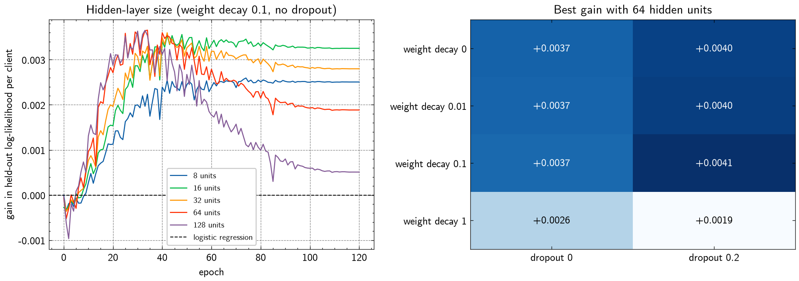

Every hidden-layer size from 8 to 128 units peaks at about the same gain (+0.0026 to +0.0037 log-likelihood per client over a logistic regression on the same 68 features), and larger networks start overfitting sooner. Dropout 0.2 adds a little; weight decay makes no difference until it is strong enough to hurt. The chosen network has 64 hidden units, weight decay 0.1 and dropout 0.2. With dropout and the cosine schedule, the held-out score levels off instead of falling back, and early stopping picks epoch 110:

  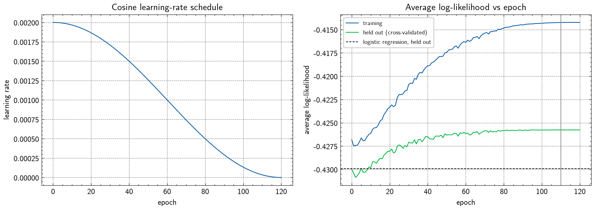

Test **AUC 0.785**, +0.003 over the logistic regression (95% interval −0.001 to +0.007). At its threshold of 0.21 it catches 859 of 1,326 defaulters with 1,058 false alarms:

  

## Gradient boosting

`gradient_boosting.ipynb`. XGBoost, improved one step at a time. Each step is scored on 5 folds × 3 different shufflings (the differences are too small for a single 5-fold split) and kept only if it helps:

  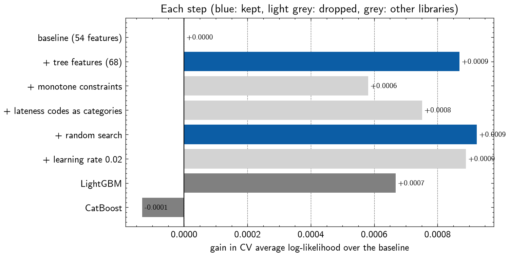

Only the extra features helped (cross-validated AUC 0.790 → 0.791). Monotone constraints, treating the lateness codes as categories, a 30-point random search, a lower learning rate and averaging 5 seeds all changed the score by 0.0003 or less. LightGBM and CatBoost land in the same place.

  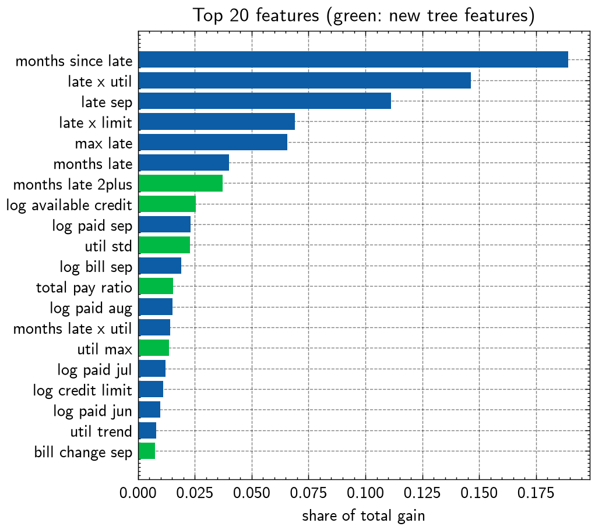
  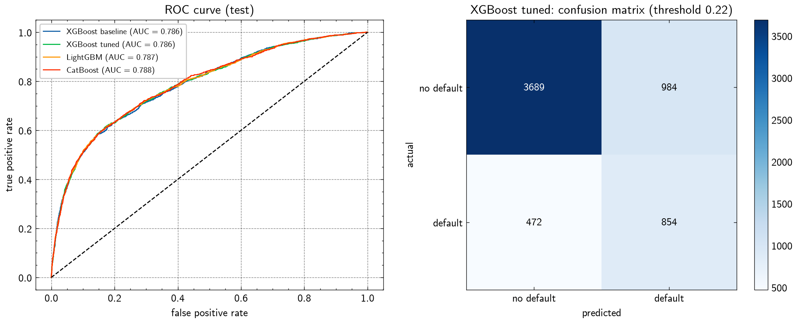

The trees rely most on how recently and how badly the client was late, and on the hand-made `late_x_util` interaction. Test **AUC 0.786**; LightGBM 0.787, CatBoost 0.788 (all within noise).

## Comparison

| model | features | cross-validated log-likelihood | test AUC |
|---|---|---|---|
| logistic regression | 18 | −0.4308 | 0.782 |
| neural network | 68 | −0.4258 | 0.785 |
| XGBoost (tuned) | 68 | **−0.4225** | **0.786** |

## To do

- [x] Logistic regression from scratch, with cross-validated forward selection
- [x] Neural network from scratch (backpropagation, AdamW, cosine schedule)
- [x] XGBoost benchmark, LightGBM and CatBoost comparison
- [ ] Newton's method for the logistic regression, so overlapping features (`unpaid_aug`, `util_jul`) converge
- [ ] Explainable Boosting Machine: close to boosting accuracy while staying interpretable
- [ ] Calibration check (reliability plot, Brier score)
- [ ] Permutation importance or SHAP values for the network and XGBoost
- [ ] Repeated cross-validation for the logistic regression and the network, as for XGBoost
