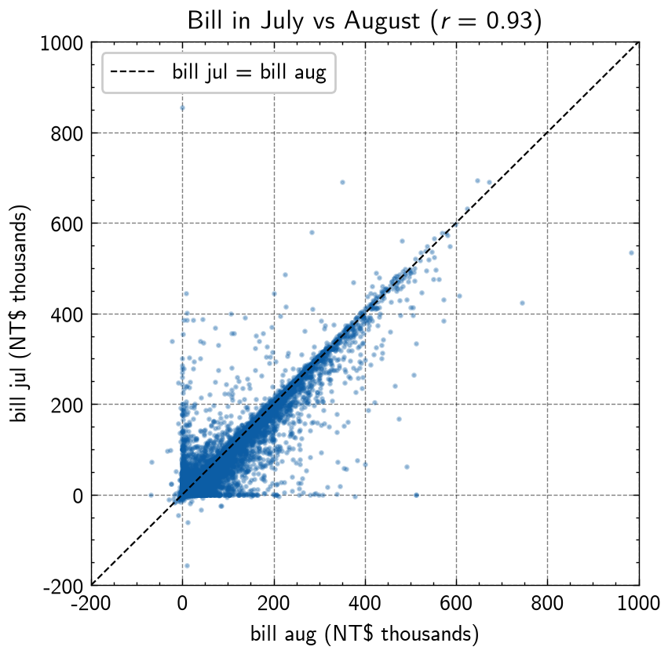
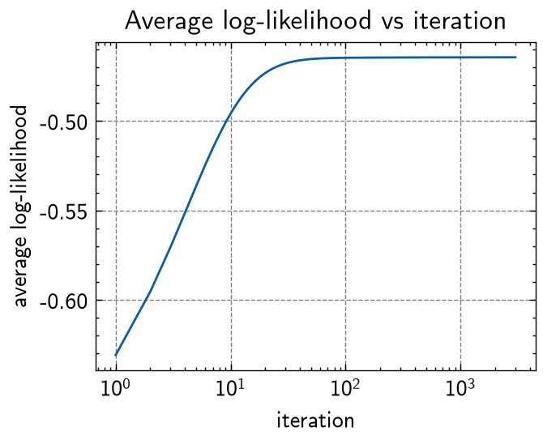
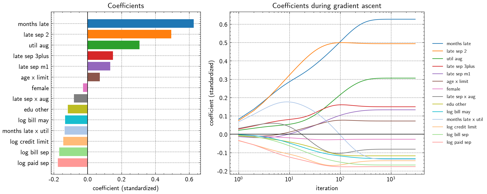
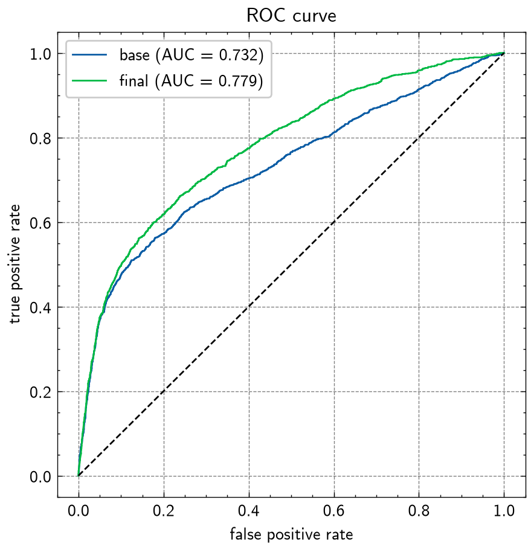
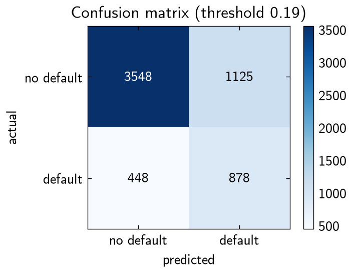
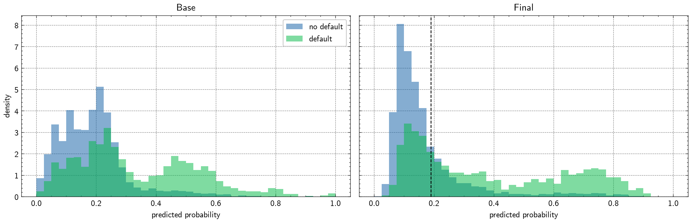
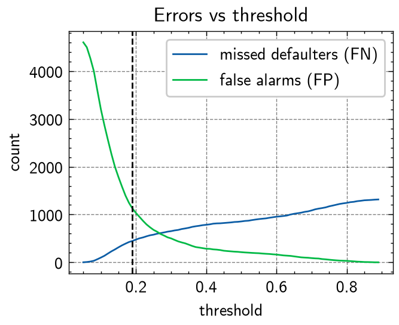

# Credit card default

Predicting whether a credit card client defaults next month, with a logistic regression written from scratch in NumPy.

Data: [Default of Credit Card Clients](https://archive.ics.uci.edu/dataset/350/default+of+credit+card+clients) (UCI). 30,000 clients in Taiwan, April to September 2005; 22% defaulted in October.

## Layout

```
code/
  eda.ipynb                  exploration, cleaning, feature engineering -> curated data
  logistic_regression.ipynb  model, feature selection, threshold, evaluation
data/
  raw/       original .xls, never edited
  curated/   credit_default.csv, written by eda.ipynb
plots/       every figure, written by the notebooks
```

Run `eda.ipynb` first, then `logistic_regression.ipynb`. Needs `numpy`, `pandas`, `matplotlib`, `scienceplots`, `xlrd`.

## Data and preparation (`eda.ipynb`)

Each client has a credit limit, demographics, and six months (April to September) of payment history:

| feature | meaning |
|---|---|
| `credit_limit` | credit limit (TWD) |
| `sex`, `education`, `marital_status`, `age` | demographics |
| `late_sep` … `late_apr` | repayment status that month (−2 = no balance, −1 = paid in full, 0 = paid the minimum, 1–9 = months late) |
| `bill_sep` … `bill_apr` | bill statement amount (TWD) |
| `paid_sep` … `paid_apr` | amount paid that month (TWD) |
| `default` | defaulted in October (target) |

Within each group the months are strongly correlated. Bills are almost the same from one month to the next (r = 0.93 for July vs August, boxed in red) because unpaid balances carry over, so most clients sit on the diagonal of the scatter. So most months add little new information, and the selected model uses only a few months from each group.

<p align="center">
  
  
</p>

- Undocumented `education` and `marital_status` codes folded into "other".
- **Negative bills.** 6.4% of clients have a negative bill: a credit balance from overpaying. These are clipped to 0 and kept as `credit_balance_months`. 6 clients whose credit balance exceeded their whole credit limit (refunds or reversals) are dropped.
- **Log transform.** Bill and payment amounts are heavily right-skewed (`paid_sep` skewness 14.7), so they are replaced by `log(1 + x)`.
- **New features.** `late_sep` as 0/1 columns (its codes are not evenly spaced), utilization `util_* = bill / credit_limit`, `months_late`, and five interaction terms such as `months_late_x_util`.

## Model

Logistic regression, $p_i = \sigma(x_i^\top \beta)$, fit by gradient ascent on the log-likelihood $\ell(\beta) = \sum_i [y_i \log p_i + (1-y_i)\log(1-p_i)]$, whose gradient is $\sum_i (y_i - p_i)\,x_{ij}$. Features are standardized with training-set statistics; $\beta$ starts at 0, learning rate 0.5, 3,000 iterations.

**Data split: 60 / 20 / 20.** The data is split into about 18,000 train, 6,000 validation and 6,000 test clients. Each part is sized for its job:
- **Train.** The model doesn't need more than this. With the final features, validation AUC is 0.775 when trained on 1,000 clients, 0.782 on 5,000 and 0.783 on all 18,000, so it has stopped improving well before the full set.
- **Validation.** Every feature-selection step and the threshold are chosen on this set, so it needs to be big enough that those comparisons aren't noise.
- **Test.** Used once, for the final numbers. Its ~1,300 defaulters put the standard error of the test AUC at about 0.008. A 1,000-client test set (~210 defaulters) would give about 0.016, too noisy to compare models. Test clients are picked by id, so they stay the same even if cleaning drops rows.

<p align="center">
  
  
</p>

The split is random rather than stratified, but each set still has about 22% defaulters (22.0%, 22.6%, 22.1%). So results on validation and test aren't skewed by a different class balance.

**Feature selection.** Forward selection on validation log-likelihood (stop when the gain is below 2) keeps 14 of 44 candidates; `months_late` enters first by a wide margin.

**Threshold.** At 0.5 most defaulters slip through (451 of 1,326 caught on test). The threshold is set on the validation set to catch about 65% of them: **0.19**. This is close to the threshold that maximises Youden's J (catch rate + true-negative rate − 1), 0.20. There is no single best threshold: if missing a defaulter costs *k* false alarms, the best threshold on validation is 0.29 for *k* = 2, 0.26 for *k* = 3 (also best F1) and 0.16 for *k* = 5. These are roughly 1/(1 + *k*), the value for perfectly calibrated probabilities. Picking the right *k* is a business decision, not something the data can tell you.

## Results

Average log-likelihood per client (≤ 0, closer to 0 is better):

| | avg. log-likelihood |
|---|---|
| $\beta = 0$ (every $p_i = 0.5$) | −0.693 |
| base rate 22% for everyone | −0.526 |
| base model, train | −0.463 |
| final model, validation | −0.436 |

On 6,000 test clients:

| | base model | final model |
|---|---|---|
| features | 26 raw | 14 selected |
| ROC AUC | 0.731 | **0.777** |
| defaulters caught (threshold 0.19) | | **857 / 1,326** (65%) |
| false alarms | | 1,101 |

The final model's AUC is about 0.78 on both validation (0.783) and test, and its gain over the base model (+0.046) is far larger than the test noise (standard error about 0.008).

<p align="center">
  
</p>

The log-likelihood is flat after about 100 iterations, but the coefficients take until about 300 to settle:

<p align="center">
  
</p>

The largest coefficients are payment history (`months_late`, `late_sep_2`). A higher credit limit, larger bills and larger recent payments lower the risk. The paths show how correlated features share credit. `months_late_x_util` rises to +0.18 early on, then flips to −0.13 once `months_late` and `util_aug` grow and take over the effect it had been standing in for. A coefficient is the effect of a feature *with the others held fixed*, so it can't be read on its own when features overlap.

<p align="center">
  
  
</p>

<p align="center">
  
</p>

The final model pushes most non-defaulters into a tight peak near 0.1, while defaulters spread out to the right; the dashed line is the 0.19 threshold. Moving it trades missed defaulters for false alarms:

<p align="center">
  
</p>
# credit-card-default
